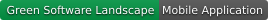

# Add the Green Software Landscape badge to the README

**Repo:** [powdroid-project/powdroid](https://github.com/powdroid-project/powdroid) · **Landscape entry:** PowDroid · **Sub-category:** Mobile Application

---

Hi! PowDroid is listed in the [Green Software Landscape](https://landscape.bundesverband-green-software.de), a directory of relevant Green Software tools categorized into a landscape. It is run by the [Bundesverband Green Software](https://www.bundesverband-green-software.de/), a German NGO with currently over 30 member companies. The landscape itself is open source: [bundesverband-green-software/landscape](https://github.com/bundesverband-green-software/landscape).

We recently started to provide badges, one per sub-category of the landscape. PowDroid would fit **Mobile Application**.

[](https://landscape.bundesverband-green-software.de)

To show it in your README, copy either line:

Badge hosted in our repo ([list of all badges](https://github.com/bundesverband-green-software/landscape/blob/main/BADGES.md)):

```markdown
[](https://landscape.bundesverband-green-software.de)
```

Via shields.io ([list of all shields.io badges](https://github.com/bundesverband-green-software/landscape/blob/main/BADGES_SHIELDS_IO.md)):

```markdown
[](https://landscape.bundesverband-green-software.de)
```

No obligation — close this if you would rather not carry the badge.
